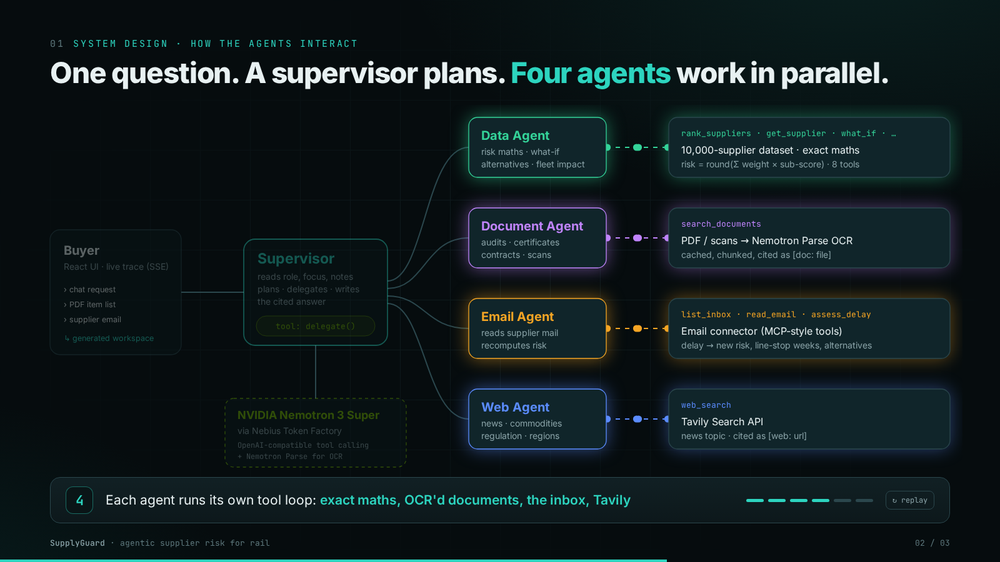
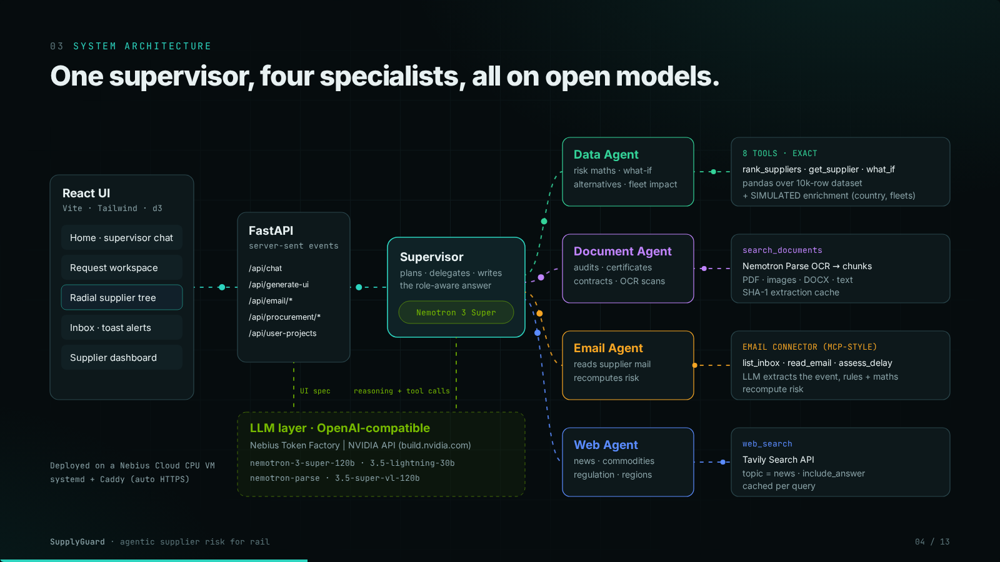
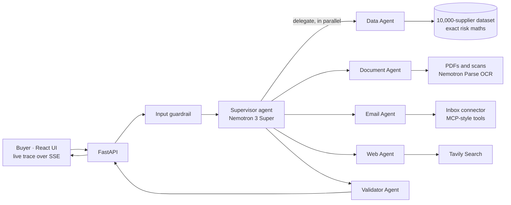

# SupplyGuard

**See supplier risk early. Switch suppliers in time.**

SupplyGuard is an agentic supplier-risk assistant for railway procurement, built for the project sponsor **Siemens Mobility**
at the {Tech: Europe} × Nebius × NVIDIA hackathon, Berlin, October 2026.

A buyer describes what they need to procure. A **supervisor agent** on **NVIDIA Nemotron** sends work in parallel to four
specialist agents: supplier data, shared documents, the email inbox and the web. It returns:

- who to buy from and who to avoid for each item,
- the exact risk score behind each choice, with sources,
- what changes when a supplier reports a disruption.

The agents propose, and the buyer decides.

## Interactive presentations

Animated slides showing the system design and how the agents interact. Click to open in the browser:

| Presentation | What it shows | Open |
|---|---|---|
| **System intro** (3 slides) | Opening slide, then the system design with an animated agent-interaction sequence, then a live-demo launcher with scenarios | [▶ Open](https://raw.githack.com/EmilieD8/Track_records/main/docs/presentations/system_intro.html) |
| **System showcase** (13 slides) | Full walkthrough: architecture, agent orchestration, data tools, OCR with Nemotron Parse, Tavily, email connector, generated UI, trust, partner tech | [▶ Open](https://raw.githack.com/EmilieD8/Track_records/main/docs/presentations/system_showcase.html) |
| **Data explainer** | Analysis of the 10,000-supplier dataset and the risk scoring | [▶ Open](https://raw.githack.com/EmilieD8/Track_records/main/docs/presentations/data_explainer.html) |

Controls: **← / →** move between slides, **F** fullscreen, **A** autoplay (showcase), **R** replay the animation (intro).
Locally, open the files in `docs/presentations/` directly, for example `xdg-open docs/presentations/system_intro.html`.

| Agent interaction (click for the animated version) | System architecture |
|---|---|
| [](https://raw.githack.com/EmilieD8/Track_records/main/docs/presentations/system_intro.html#2) | [](https://raw.githack.com/EmilieD8/Track_records/main/docs/presentations/system_showcase.html#4) |

---

## The problem

Rail procurement teams manage thousands of suppliers, each scored on many risk factors. Three things go wrong:

- **Headline scores hide risk.** In the 10,000-supplier dataset, **911 suppliers** are rated Low or Medium overall but have
  a **Critical** sub-score (finances, quality, compliance…). The average hides the danger.
- **Signals are scattered.** Audit PDFs, scanned certificates, supplier emails about delays and news on strikes or commodity
  prices all live in different places. Nobody links them back to the risk score.
- **One dashboard fits nobody.** A strategic buyer, a risk manager and a CFO ask different questions of the same data.

## What SupplyGuard does

| Feature | What the user gets |
|---|---|
| **Request workspace** | Describe items in chat or upload a bill-of-materials PDF. Nemotron extracts the items, asks for constraints (EU only?) and a priority (lowest risk, delivery reliability or proven volume), then builds a **radial supplier tree** (items → suppliers that can deliver them, coloured by risk). Each item gets a recommended supplier and a supplier to avoid. |
| **Supplier dashboard** | Exact score breakdown (points per factor), 24-month trend, fleet impact, order ledger, buyer notes and live news. |
| **Email connector** | A supplier emails about a delay. The Email Agent extracts the event, recomputes the risk and shows line-stop weeks against safety stock, plus alternatives. Nothing changes until the buyer approves. |
| **Supervisor chat** | Ask anything ("Which brake suppliers should I worry about this week?"). A live trace shows every agent step, and the answer cites every claim. |
| **Generated workspace** | On first sign-in, Nemotron writes a layout spec for the user's role. It is checked against a fixed component list, and the LLM never writes code. |
| **Security layer** | Input guardrails, user-defined boundaries, a Validator Agent, human approval and an audit log. |

## How it works



1. **The buyer asks.** The question can be typed in the chat, uploaded as a PDF, or triggered by an incoming supplier email.
2. **The input guardrail** blocks prompt injection and redacts secrets such as API keys and IBANs.
3. **The Supervisor** (Nemotron 3 Super) reads the user's role, focus and boundaries, then makes one `delegate()` call that
   starts the specialist agents **in parallel**.
4. **Each agent runs its own tool-calling loop**, using exact tools instead of LLM guesses.
5. **The Validator Agent** checks the answer before the user sees it:
   - every figure traces back to a tool result,
   - every supplier ID exists,
   - the user's boundaries are respected,
   - citations are present.

   An answer that breaks a boundary is withheld.
6. **The answer and every agent step stream to the UI.** Proposed actions come with Approve and Reject buttons, and every
   decision goes to the audit log.

### Agents and tools

| Agent | Tools | Backed by |
|---|---|---|
| **Supervisor** | `delegate(data_task, document_task, email_task, web_task)` | Nemotron 3 Super with the user profile and boundaries in its system prompt |
| **Data Agent** | `portfolio_overview`, `rank_suppliers`, `get_supplier`, `compare_suppliers`, `what_if`, `find_alternatives`, `risk_history`, `fleet_impact` | pandas over the 10,000-supplier dataset, plus enrichment data |
| **Document Agent** | `search_documents` | PDF, DOCX and images. Scanned pages are read by **NVIDIA Nemotron Parse**. Results are cached by file hash and split into chunks. |
| **Email Agent** | `list_inbox`, `read_email`, `assess_delay` | Simulated inbox. Nemotron extracts the event, then rules and exact maths recompute the risk. |
| **Web Agent** | `web_search` | **Tavily** (news topic). Supplier names are anonymised, so it searches by part category, country and topic. |
| **Validator Agent** | Deterministic checks | Grounding, supplier IDs, boundaries, citations, leakage |

### Explainable risk: no invented numbers

We reverse-engineered the dataset's risk index exactly. A least-squares fit over all 10,000 suppliers has an RMSE of 0.29,
which is just integer rounding:

```
Total_Risk_Index = round( Σ weight_i × sub_score_i )      # 18 factors, weights sum to 1.00
Levels: Low < 25 ≤ Medium < 50 ≤ High < 75 ≤ Critical
```

Every point of every score can be traced to a factor. The LLM picks the tool and explains the result, and the tool does the
maths.

| Weight | Factors |
|---|---|
| 0.10 | Operational Resilience, Financial Health, Quality Risk |
| 0.08 | Compliance Risk |
| 0.06 | Credit Rating, Safety Incident, Sub-Tier Visibility |
| 0.05 | Geopolitical, Governance, ESG |
| 0.04 | Environmental, Labor Stability, Digital Security, Political Stability, Industry Benchmark |
| 0.03 | Market Sentiment, Media Sentiment, External Intelligence |

- **Hidden risk:** total below 50 and any factor at 75 or above. This finds 911 suppliers.
- **Exposure:** PO volume × total risk / 100. That is €10.3B of the €20.4B annual spend.

### Example: one email changes the recommendation

A supplier emails a 6-week delay on BCU-7 brake control units. The cause is a casting sub-supplier and cash-flow constraints.

| | Before | After |
|---|---|---|
| Total risk (SUPP_01703) | 15 | 21 |
| Delivery rating | 100% | 85% |
| Line-stop risk | — | 2 weeks (6-week delay vs 4-week safety stock) |
| Recommendable (risk < 50 and delivery ≥ 90%) | yes | no |
| BCU-7 pick for RegioFlex (EU, lowest risk) | Elite Systems 250 (risk 15) | Global Group 863 (risk 42) once the buyer approves |

## Security: the user stays in control

| Layer | What it does |
|---|---|
| Input guardrail | Blocks prompt-injection patterns and redacts API keys, IBANs and card numbers. |
| Untrusted content | Email, document and web text is treated as data, never as instructions. Embedded instructions are flagged (demo: a phishing email). |
| User boundaries | The user sets the maximum risk of a recommended supplier, EU only, IRIS required, a € approval threshold and web on or off. These become hard rules for the supervisor. |
| Validator Agent | Checks every answer and withholds any answer that breaks a boundary. |
| Human in the loop | Actions need Approve or Reject. Email-driven risk changes only apply after approval. |
| Least-privilege connectors | The supplier DB, email (read only) and web search must each be authorised. Revoking a connector removes its agent. |
| Audit log | Records blocked inputs, validator verdicts, approvals, rejections and boundary changes. |

## Partner technology

| Partner | How we use it |
|---|---|
| **NVIDIA Nemotron** | Every agent runs on open models: `nemotron-3-super-120b-a12b` for the supervisor, the specialist agents, UI specs, email events and item extraction. Optionally `nemotron-3.5-lightning-30b-a3b` for speed. `nemotron-parse` does OCR on scanned PDFs, with `nemotron-3.5-super-vl-120b-a12b` as the vision fallback. |
| **Nebius Token Factory** | OpenAI-compatible inference endpoint for Nemotron. The model picker lists the account's Nemotron models live. |
| **Nebius Cloud** | A CPU VM (`cpu-d3`, 4 vCPU) runs the Docker stack behind Caddy with automatic HTTPS. |
| **Tavily** | The Web Agent's `web_search` and the supplier news feed (3 parallel queries by category and country), cached and cited by URL. |

**Open stack:** FastAPI, Server-Sent Events, pandas, PyMuPDF, React 18, Vite, Tailwind 4, d3-hierarchy, Recharts, Docker,
nginx and Caddy.

## Real vs simulated

| Real | Simulated (labelled in the UI) |
|---|---|
| 10,000-supplier risk dataset, 18 sub-scores, weighted index | Country, part category, IRIS certificates, lead time, safety stock |
| Nemotron agents, tool calling, OCR on the sample documents | Fleet bill of materials, 24-month history, purchase-order ledger |
| Tavily web search | Email inbox and supplier emails |
| | Score uplift rules for email-reported delays |

## Run it

```bash
make install                      # Python venv (poc/.venv) + npm packages
cp poc/.env.example poc/.env      # add NEBIUS_API_KEY, NVIDIA_API_KEY, TAVILY_API_KEY
make dev                          # API on :8000 + UI on http://localhost:5173
```

Other options:

```bash
make docker-up                    # both containers, UI on http://localhost:8090
make deploy VM=user@<ip>          # Nebius VM: Docker + Caddy HTTPS at https://<ip-with-dashes>.sslip.io
                                  # demo password gate: demo / supplyguard2026 (override with AUTH_USER / AUTH_PASS)
```

Without API keys the app still runs:

- email and item extraction fall back to regex and keyword matching,
- the workspace layout falls back to a template.

**Demo flow:**

1. Sign in as Lena Weber (Strategic Buyer) and authorise the connectors.
2. Open the "RegioFlex brakes & bogies" example.
3. Simulate the supplier delay email, then analyse and approve it.
4. Ask the supervisor a question.
5. Try a prompt injection.

## Repository

```
poc/                          FastAPI backend
  api.py                      endpoints, SSE chat stream
  agents.py                   supervisor + specialist tool-calling loops
  data_tools.py               exact risk maths over the dataset
  extract.py                  PDF / DOCX / OCR (Nemotron Parse) + chunk search
  email_connector.py          simulated inbox, MCP-style tools, risk recompute
  web.py                      Tavily search with cache
  workspace.py                request intake, supplier tree, recommendations, generated UI spec
  guardrails.py               input guard, boundaries, Validator Agent, approvals, audit log
  data/                       supplier_risk_dataset.csv (10,000 rows) + SIMULATED enrichment
  sample_docs/                documents the Document Agent indexes (audits, certificates, contracts…)
    demo_docs/                bill-of-materials PDFs to upload in the request intake
  scripts/                    key check, demo data generator
  deploy/                     Nebius VM deploy (Docker + Caddy), see NEBIUS_VM.md
web/                          React + Vite + Tailwind UI (radial tree, bubbles, live trace)
docker/                       API / web Dockerfiles, nginx config
docs/
  presentations/              system intro, system showcase, data explainer (HTML slides)
  images/                     architecture screenshots used in this README
  SUMMARY.md                  hackathon wrap-up and 2-minute demo shot list
  planning/                   roadmap, guideline, research reports, risk criteria
  design/ui_first_draft/      first UI mock-ups
Makefile                      install · dev · docker-up · deploy
docker-compose.yml            api + web containers
vercel.json                   alternative Vercel deployment (FastAPI + Vite services)
```

## Next steps

- Replace the simulated inbox with a real IMAP or Microsoft Graph connector, exposed as an MCP server.
- Keep one document index per project instead of one shared index.
- Calibrate the delay rules on historical delivery and PO data.
- Add real authentication and role-based access.
- Self-host Nemotron as NVIDIA NIM on a Nebius GPU VM for fully on-premises deployment.
