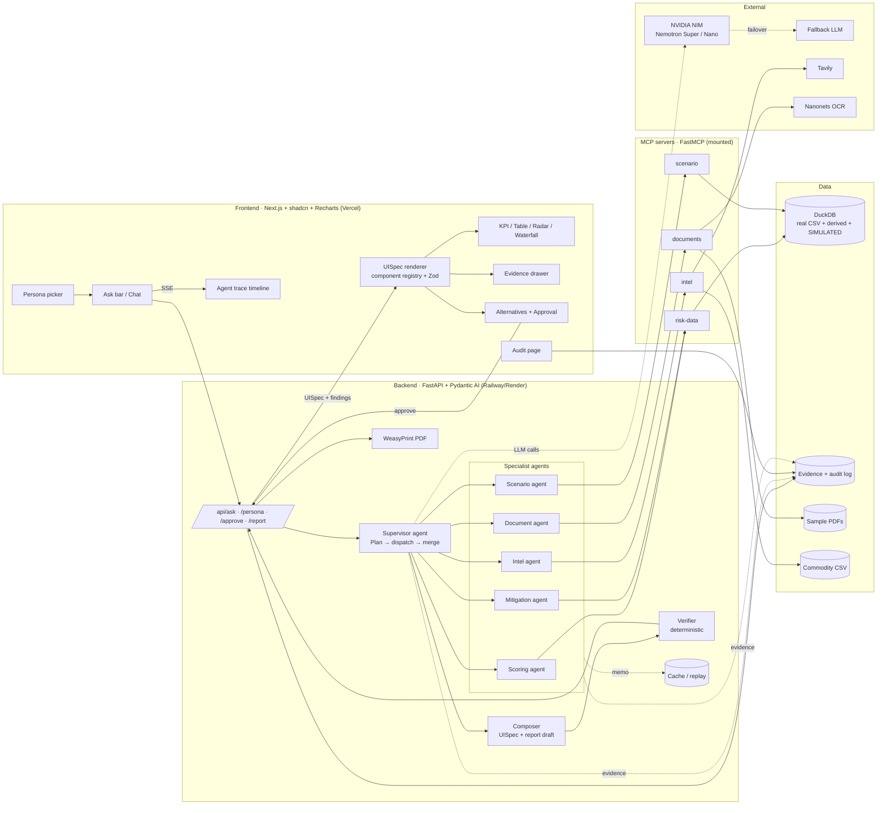

# 03 — Solution Architecture: Agentic Supplier Risk Assessment (Railway)

**Team:** 1 tech lead (codes) + 1 presenter · **Time:** 24–36 h · **Event:** {Tech: Europe} AI Hackathon, Oct 2026
**Inputs reviewed:** `supplier_risk_dataset.csv` (10,000 rows × 46 cols), `risk_criteria_description.md`, whiteboard `assests/Brainstorm_v1.jpeg`.

**Working product name (placeholder):** **RailGuard**, a supplier risk copilot for rail procurement.

---

## 0. TL;DR

- **Build one golden path end to end.** It should be bulletproof, not ten features at 60 %.
- **Wow moment.** A risk manager asks one question in plain language. Agents visibly fan out (live trace). A persona-specific dashboard **assembles itself**. The system surfaces a **hidden risk**: a supplier rated *Medium* overall but *Critical* on financial health, single-sourced for brake components and carrying high € exposure. It proposes **ranked alternative suppliers**, and the human clicks **Approve**, which writes to the audit log and produces a PDF. Then the presenter switches persona to **CFO**, and the same findings re-render as a € exposure view.
- **Stack.** Python FastAPI + **Pydantic AI** agents + **FastMCP** tool servers + **DuckDB**, with **NVIDIA Nemotron via NIM** (OpenAI-compatible) as the LLM. The frontend is **Next.js + shadcn/ui + Recharts**, rendering an LLM-emitted **JSON UI spec** through a fixed component registry. The frontend deploys to Vercel and the backend to Railway/Render.
- **Key data insight (verified):** `Total_Risk_Index` is *exactly* a weighted linear sum of the 18 sub-scores (least-squares fit, RMSE 0.29, which is just rounding). We recovered the weights (table in §4.2). Every total score is therefore **fully decomposable into per-criterion contributions**. That is our explainability backbone, and it costs nothing to compute.
- **Hidden-risk population (verified):** **911 suppliers** have an overall level of Low/Medium but at least one **Critical** sub-score. Those are the stories to tell.

---

## 1. Critique of the whiteboard draft

### 1.1 What is good
- The **supervisor + sub-agents behind MCP** framing is on-trend and easy to explain to judges.
- **Persona-driven UI on demand** is the strongest differentiator. Most teams will ship a static dashboard plus a chatbot.
- Tavily for external signals and an OCR doc pipeline are both credible "agentic evidence gathering".
- The deliverables (risk report, comparison, forecast) map to real procurement jobs.

### 1.2 What is too much for 2 people / 24–36 h

| Whiteboard item | Verdict | Why / replacement |
|---|---|---|
| Company vendor history DBs + **BOMs** | **Simulate thin** | No BOM data exists. Generate a small synthetic BOM: about 12 railway part categories × about 40 assemblies, mapping parts to suppliers. Label it **SIMULATED**. |
| **Real-time** delay tracking, stock status, supply-chain tracking | **Cut to "simulated weekly snapshots"** | There is no live feed. Fake real time convinces nobody. Use synthetic 52-week history per supplier, seeded from current KPIs, and show "last refreshed" honestly. |
| **Stock forecasting** | **Reduce** to "days-of-cover / delivery-performance forecast" for parts in the golden flow | Real inventory forecasting needs data we don't have. Use Holt/ETS on simulated series, about 2 h. |
| n-vs-n comparison of items | **Keep, as supplier-vs-supplier** (2–4 suppliers) | It is cheap because the data is already there. Use a radar plus a delta table. |
| **Stock market of resources** (steel, copper prices) | **Add-on, stretch only** | Ship a static CSV of about 24 monthly points for steel/copper/aluminium (public data, cached) and a single "commodity pressure" tile. Do not integrate a live market API. |
| News | **Keep via Tavily**, but see the caveat below | — |
| Nanonets OCR | **Keep, but pre-baked** | Prepare 3 sample docs (ISO 9001 / IRIS (ISO/TS 22163) certificate, audit report, invoice). Run them live once, cache the outputs, and replay if the API is slow. |
| Separate DB per data source | **Cut** | One DuckDB file. |
| UI fully generated per user (raw code) | **Replace** with JSON spec → fixed components | Raw generated code is slow, flaky and unsafe on stage. |
| Many sub-agents | **Cap at 5 specialists + supervisor** | Each extra agent adds latency and failure modes. Some "agents" should be deterministic functions. |

### 1.3 Critical caveat: Tavily vs. synthetic supplier names
Supplier names are synthetic and repeat across rows. There are only **64 distinct base names** ("Apex Technologies 491" and so on), so a web search by supplier name returns **nothing relevant**. Two fixes:
1. **Contextual intel:** the Intel agent searches by the supplier's (simulated) **country + category + commodity**, for example "rail brake component supplier strike Germany 2026" or "steel price Europe October 2026". It reports results as *contextual signals*, never as supplier-specific facts.
2. **Live "assess a new supplier" mode** (stretch, high wow): a judge types a **real** company name, such as a public rail supplier. Tavily and OCR of an uploaded certificate produce a **provisional** risk profile on the same 18 criteria, clearly flagged "provisional, web-sourced, needs analyst review". Keep the language neutral and evidence-cited.

### 1.4 The wow moment (design everything around it)
> "Which critical brake suppliers should I worry about this week?"
> → a live agent trace (5 agents light up) → a dashboard assembles in about 15–25 s → a **hidden-risk card**: "SUPP_0xxxx is rated *Medium* (44) but **Financial Health = 96 (Critical)**, single source for 3 brake assemblies, €4.1 M open PO volume" → evidence drawer (score decomposition, OCR'd audit finding, 2 news items) → 3 ranked alternatives → **Approve** → PDF + audit entry.
> Then: "Show me this as the CFO" → the same facts re-render as € at risk, a concentration chart and a mitigation cost.

---

## 2. Agent topology

### 2.1 Framework recommendation: **Pydantic AI** (+ FastMCP)

| Option | Speed to build | Typed I/O | MCP client | Non-OpenAI LLM (NIM) | Verdict |
|---|---|---|---|---|---|
| **Pydantic AI** | High | Native (Pydantic output types, validation + retries) | Native (`MCPServerStdio` / streamable HTTP) | `OpenAIChatModel` + `OpenAIProvider(base_url=NIM)`; `FallbackModel` built in | **Recommended** |
| LangGraph | Medium | Manual | Via adapters | Yes | Good for complex graphs/interrupts. More boilerplate than this needs. |
| OpenAI Agents SDK | High | Good | Yes | Yes, via `OpenAIChatCompletionsModel` | Fine. Handoff semantics and tracing are tuned for OpenAI. |
| Mastra (TS) | High | Zod | Yes | Yes | Only if the lead is TS-first. Python is better for DuckDB/forecasting. |
| Claude Agent SDK | High | Good | Excellent | Built around Claude, not Nemotron | Conflicts with the "NVIDIA LLM" story. Good fallback runtime. |

**Why Pydantic AI:**
1. **Structured outputs are first-class.** Every agent returns a validated Pydantic model, and malformed LLM JSON triggers an automatic retry. This matters with open models.
2. **`FallbackModel`** gives Nemotron → secondary NIM model → other provider failover in one line.
3. It is an **MCP client out of the box**, and **FastMCP** builds the servers in about 20 lines each.
4. "Agent-as-tool" delegation (supervisor calls `run_scoring_agent(...)` as a tool) is a simple, debuggable supervisor pattern.
5. Logfire/OTel tracing is optional. We stream our own trace events to the UI anyway.

### 2.2 LLM plan

| Role | Primary (NIM, `https://integrate.api.nvidia.com/v1`) | Fallback |
|---|---|---|
| Supervisor / planner, report writer | A Nemotron **Super**-class model, e.g. `nvidia/llama-3.3-nemotron-super-49b-v1.5` or the current Nemotron 3 Super if listed (reasoning on) | Nemotron Nano → any OpenAI-compatible model (OpenRouter/Groq) → **cached replay** |
| Specialist agents (tool calling, extraction) | A Nemotron **Nano**-class model (e.g. `nvidia/nvidia-nemotron-nano-9b-v2` / Nemotron 3 Nano), reasoning off for speed | Same chain |
| UI spec composer | Nano + strict JSON schema output | Deterministic template per persona |

> Verify exact model IDs and tool-calling support on build.nvidia.com at the event. Model IDs churn. Put them in env vars only. Nemotron reasoning is toggled via system prompt (`/think` or `/no_think` on v1.5-era models). Test tool calling with each model in hour 1.

**Rate/latency defence:** use `temperature=0.2` and `max_tokens` caps. Run specialists **in parallel** (`asyncio.gather`). Keep a disk cache keyed by `(agent, normalized_input_hash)`.

### 2.3 Agents (5 specialists + supervisor)

```
Supervisor (planner/router/synthesizer)
 ├── 1. Scoring Agent        (DuckDB, deterministic math; LLM only to pick tools/params)
 ├── 2. Intel Agent          (Tavily news + commodity context)
 ├── 3. Document Agent       (Nanonets OCR → structured evidence)
 ├── 4. Scenario Agent       (forecast + what-if impact over simulated BOM/time series)
 ├── 5. Mitigation Agent     (alternative suppliers, actions)
 └── Composer (Report + UI spec) — runs last; output validated by a deterministic Verifier
```

**Design rule:** *the LLM never computes a number.* All numbers come from tools (SQL or Python). The LLM selects, explains and composes. A deterministic **Verifier** checks that every number in the narrative exists in the evidence ledger (§5).

#### Supervisor
- **Input:** `UserQuery {text, persona, session_id}`
- **Steps:** (1) parse the intent into a `Plan` (structured output). (2) Dispatch specialist calls in parallel where independent. (3) Merge into a `Findings` bundle. (4) Call the Composer. (5) Run the Verifier. (6) Stream to the UI.
- **Tools:** `run_scoring`, `run_intel`, `run_documents`, `run_scenario`, `run_mitigation`, `compose`.

```json
// Plan (supervisor structured output)
{
  "intent": "triage | compare | explain_supplier | what_if | find_alternatives | report",
  "filters": {"category": "Brakes", "min_level": "High", "country": null, "time_window_days": 7},
  "supplier_ids": [],
  "persona": "risk_manager | procurement_buyer | cfo | engineer",
  "steps": [
    {"agent": "scoring", "args": {"...": "..."}, "depends_on": []},
    {"agent": "intel", "args": {"...": "..."}, "depends_on": ["scoring"]}
  ]
}
```

#### 1. Scoring / Data Agent
- **MCP server:** `risk-data` (FastMCP over DuckDB, **read-only** connection).
- **Tools (parameterized, no free-form SQL by default):**
  - `search_suppliers(category?, country?, min_level?, hidden_risk_only?, sort_by, limit)`
  - `get_supplier_profile(supplier_id)`: 18 sub-scores, levels, ops KPIs, derived features
  - `explain_score(supplier_id)`: per-criterion contribution `w_i × s_i`, sorted
  - `compare_suppliers(ids[2..4])`
  - `portfolio_kpis(filters)`: counts by level, € exposure, concentration
  - `run_readonly_sql(sql)` (*guarded*: SELECT only, whitelisted views, LIMIT 500, 2 s timeout). Use it for the "ask anything" chat. Log the SQL as evidence.
- **Output:**
```json
{
  "suppliers": [{
    "supplier_id": "SUPP_00001", "name": "Apex Technologies 491",
    "total_risk": 68, "level": "High",
    "action_priority": 87.4,
    "exposure_eur": 88273.8,
    "hidden_risk_flags": ["CRITICAL_SUBSCORE_UNDER_HIGH_TOTAL"],
    "top_drivers": [{"criterion": "Financial_Health", "score": 96, "weight": 0.10, "contribution": 9.6}],
    "ops": {"po_volume_eur": 129814.45, "order_change_rate": 6.12, "delivery_rating": 84.27, "confirmation_rate": 77.56,
            "sourcing_risk": "High", "complexity": "Simple"},
    "evidence_ids": ["ev_sql_0012", "ev_calc_0031"]
  }],
  "kpis": {"n_total": 41, "n_critical": 6, "eur_at_risk": 12400000},
  "evidence": [{"id": "ev_sql_0012", "type": "sql", "query": "...", "row_count": 41}]
}
```

#### 2. Intel Agent
- **MCP server:** `intel` (wraps Tavily `search` with `topic="news"`, `days=7–30`; plus a cached `commodity_prices(material)` from a static CSV).
- **Tools:** `news_search(query, days, max_results)`, `commodity_trend(material)`, `country_context(country)`.
- **LLM job:** build 2–4 targeted queries from (category, country, commodity). Classify each hit as `{risk_type ∈ 18 criteria, polarity, severity 1–5, relevance}` and **quote the source snippet**.
- **Output:**
```json
{"signals": [{
  "id": "ev_news_0004", "title": "...", "url": "https://...", "published": "2026-10-14",
  "snippet": "verbatim text from source",
  "mapped_criterion": "Labor_Stability", "severity": 4, "scope": "contextual|supplier_specific",
  "confidence": 0.7
}], "commodities": [{"material": "steel", "change_3m_pct": 6.2, "source": "static_cache_2026-10"}]}
```

#### 3. Document Agent
- **MCP server:** `documents` (Nanonets OCR API: document → markdown/JSON. Cache by file hash. Fallback: pre-extracted JSON in `data/docs/*.json`. Alternative: the open `Nanonets-OCR-s` model if self-hosting is ever needed.)
- **Tools:** `list_documents(supplier_id)`, `ocr_document(doc_id)`, `extract_fields(doc_id, schema)`.
- **Document types & extracted fields:**
  - *Certificate* (ISO 9001, IRIS/ISO 22163, ISO 14001): `{standard, issuer, valid_until, expired: bool}` → evidence for Quality/Compliance
  - *Audit report*: `{findings[{severity, text}], audit_date}` → Quality/Safety
  - *Invoice / delivery note*: `{po_no, promised_date, delivered_date, delay_days}` → Operational
- **Output:** `{documents:[{id, type, supplier_id, fields{}, page_refs[], ocr_confidence, flags:["CERT_EXPIRES_IN_30D"]}]}`

#### 4. Scenario Agent (forecast + what-if)
- **MCP server:** `scenario` (pure Python: statsmodels `ExponentialSmoothing` or a simple linear trend; BOM graph queries in DuckDB).
- **Tools:**
  - `forecast_kpi(supplier_id, kpi ∈ {delivery_rating, confirmation_rate, risk_index}, horizon_weeks=8)`: point forecast + 80 % band
  - `bom_impact(supplier_id)`: affected parts/assemblies/fleets, single-source flag, € PO at risk
  - `what_if(supplier_id, event ∈ {insolvency, 4w_disruption, +20%_price}, )`: days of cover remaining, lines affected, cost delta
- **Output:** `{forecasts:[{supplier_id,kpi,history[],forecast[],lower[],upper[],method}], impact:{parts[], single_source:bool, eur_at_risk, days_of_cover, fleets_affected[]}, assumptions[], simulated:true}`

#### 5. Mitigation Agent
- **MCP server:** reuses `risk-data` plus a `mitigation` tool set.
- **Tools:** `find_alternatives(supplier_id, k=3)`: same category (and optionally region), lower total risk, no Critical sub-scores, delivery rating ≥ 90, ranked by a `fit_score`. Also `action_playbook(driver)`: a static library mapping driver → actions (e.g., Financial_Health → "request latest financials, shorten payment terms, dual-source, escrow tooling").
- **LLM job:** pick and justify 2–3 actions. Never invent suppliers. It can only choose from tool output.
- **Output:**
```json
{"alternatives": [{"supplier_id": "SUPP_04411", "fit_score": 0.86, "total_risk": 22, "delta_vs_current": -22,
                   "why": ["same category: Brakes", "no critical sub-scores", "delivery 97.1%"]}],
 "actions": [{"action": "Qualify second source for brake pads", "owner_role": "procurement_buyer",
              "urgency": "this_week", "addresses": ["Financial_Health"], "evidence_ids": ["ev_calc_0031"]}],
 "requires_approval": true}
```

#### Composer (Report + UI spec) and Verifier
- **Composer (LLM):** input = `Findings` + `persona`. Output = `UISpec` (§3) + `ReportDraft {title, executive_summary, sections[{heading, body_md, evidence_ids[]}]}`.
- **Verifier (deterministic, not an LLM):**
  1. Every component's `data_ref` exists in the findings store.
  2. Every number in `body_md` (regex) matches a number in the evidence ledger (± rounding).
  3. Every supplier ID mentioned exists in DuckDB.
  4. Each section carries ≥ 1 `evidence_id`.

  On failure: retry the Composer once with the error list, then fall back to the persona's template spec.

### 2.4 MCP servers (one Python process, mounted)

| Server | Transport | Tools | Backing |
|---|---|---|---|
| `risk-data` | in-process / stdio (FastMCP) | search_suppliers, get_supplier_profile, explain_score, compare_suppliers, portfolio_kpis, run_readonly_sql, find_alternatives | DuckDB (read-only) |
| `intel` | stdio | news_search, commodity_trend, country_context | Tavily + static CSV |
| `documents` | stdio | list_documents, ocr_document, extract_fields | Nanonets + cache |
| `scenario` | stdio | forecast_kpi, bom_impact, what_if | Python + DuckDB |

Mount all four into one FastMCP app (`main.mount(...)`) for one deploy unit. You can also expose it over **streamable HTTP** so the presenter can show "our MCP server also plugs straight into Claude Desktop / Cursor". That is a cheap credibility point.

---

## 3. Generative UI on demand (per persona)

### 3.1 Approach: LLM → JSON `UISpec` → fixed component registry
The LLM **never writes code**. It selects components from a typed catalog, orders them, writes titles/captions, and binds each to a `data_ref` that points to data the tools produced. The frontend validates the spec with Zod and renders it. Unknown components or invalid refs are dropped.

```json
// UISpec v1
{
  "persona": "risk_manager",
  "title": "Brake suppliers: watch list, week 42",
  "layout": "grid-12",
  "components": [
    {"id": "k1", "type": "KpiRow", "span": 12, "data_ref": "kpis.portfolio",
     "props": {"items": ["n_critical", "eur_at_risk", "n_hidden_risk"]}},
    {"id": "h1", "type": "HiddenRiskCallout", "span": 12, "data_ref": "suppliers[0]"},
    {"id": "t1", "type": "SupplierTable", "span": 7, "data_ref": "suppliers",
     "props": {"columns": ["name", "level", "action_priority", "exposure_eur", "top_driver"]}},
    {"id": "r1", "type": "RiskRadar", "span": 5, "data_ref": "suppliers[0].subscores"},
    {"id": "w1", "type": "ScoreWaterfall", "span": 6, "data_ref": "suppliers[0].contributions"},
    {"id": "f1", "type": "ForecastChart", "span": 6, "data_ref": "forecasts[0]"},
    {"id": "n1", "type": "EvidenceFeed", "span": 6, "data_ref": "signals"},
    {"id": "a1", "type": "AlternativesCompare", "span": 6, "data_ref": "alternatives"},
    {"id": "x1", "type": "ApprovalPanel", "span": 12, "data_ref": "actions"}
  ],
  "narrative_md": "...", "evidence_ids": ["..."]
}
```

### 3.2 Component catalog (build about 12, all fed by the same `Findings` JSON)

`KpiRow` · `HiddenRiskCallout` · `SupplierTable` (sortable, click → drawer) · `RiskRadar` (18 axes, grouped) · `ScoreWaterfall` (contribution decomposition) · `RiskHeatmap` (category × criterion, or country × level) · `ExposureMatrix` (scatter: x = risk, y = € PO volume, size = sourcing difficulty) · `ForecastChart` (history + band) · `ComparisonView` (n-vs-n radar + delta table) · `EvidenceFeed` (news/doc/sql cards with source links) · `AlternativesCompare` · `ApprovalPanel` · `SupplierMap` (stretch; simulated countries, react-simple-maps) · `ChatPanel` (always present).

### 3.3 Persona defaults (LLM adapts within these)

| Persona | Focus | Default components | Language |
|---|---|---|---|
| **Risk manager** | Which suppliers, why, what next | KpiRow, HiddenRiskCallout, SupplierTable, Waterfall, EvidenceFeed, ApprovalPanel | Drivers, evidence, severity |
| **Procurement buyer** | Delivery, alternatives, negotiation | SupplierTable (ops KPIs), ForecastChart, AlternativesCompare, ComparisonView | Lead times, confirmation rates, switching |
| **CFO** | € exposure, concentration, cost of mitigation | KpiRow (€), ExposureMatrix, Heatmap by category €, short narrative | € at risk, % of spend, scenarios |
| **Engineer / quality** | Part/assembly impact, certificates, quality | BOM impact tree/table, Quality & Safety radar subset, doc evidence (certs, audits) | Parts, fleets, compliance (IRIS/ISO 22163, EN 15085) |

The persona switch is a single request: same `Findings`, new `UISpec`. This takes about 3–5 s, which makes a great live demo beat.

### 3.4 Stack & deployment

| Layer | Choice | Notes |
|---|---|---|
| Frontend | **Next.js (App Router) + Tailwind + shadcn/ui + Recharts** | Zod-validated `UISpec` → `components/registry.tsx`. SSE for agent trace + partial specs. |
| Faster alternative | **Streamlit** (all Python) | Use it if the lead is not fluent in React. Same JSON spec → `st.*` registry. It loses polish and is weaker on stage. |
| Backend | **FastAPI** + Pydantic AI + FastMCP | `/api/ask` (SSE), `/api/persona`, `/api/approve`, `/api/report.pdf`, `/api/audit` |
| PDF | Jinja2 HTML template → **WeasyPrint** | Charts as server-side PNG (matplotlib) or embedded SVG. Do not screenshot the UI. |
| DB | DuckDB file baked into the image | Read-only at runtime. Audit log in a separate SQLite/DuckDB file. |
| Deploy | **Frontend: Vercel. Backend: Railway or Render** (Docker). | Lovable/v0 can be used to *scaffold* component visuals quickly. Keep the registry code in the repo. |
| Local demo | `docker compose up` on the laptop | **Always demo from local, with the cloud as backup**, or the reverse if the venue Wi-Fi is good. Decide at T-3 h. |

---

## 4. Data model

### 4.1 Storage: **DuckDB** (embedded, zero-ops, fast analytics over 10k rows, reads CSV/Parquet natively)
Supabase/Postgres only adds value with multi-user auth. Skip it. If the team wants a "real DB" story, mention that the schema ports 1:1 to Postgres.

### 4.2 Verified fact: the scoring formula
A least-squares fit of `Total_Risk_Index` on the 18 sub-scores gives intercept ≈ 0 and **RMSE 0.29** (integer rounding). The weights sum to 1.00:

| Weight | Criteria |
|---|---|
| **0.10** | Operational_Resilience, Financial_Health, Quality_Risk |
| **0.08** | Compliance_Risk |
| **0.06** | Credit_Rating, Safety_Incident, Sub_Tier_Visibility |
| **0.05** | Geopolitical_Risk, Governance_Risk, ESG_Performance |
| **0.04** | Environmental_Exposure, Labor_Stability, Digital_Security, Political_Stability, Industry_Benchmark |
| **0.03** | Market_Sentiment, Media_Sentiment, External_Intelligence |

Level bands (total index, verified): **Low 6–24, Medium 25–49, High 50–74, Critical 75–93**. Distribution: High 4,813 · Medium 4,485 · Critical 384 · Low 318.
→ `explain_score` = `w_i × score_i`, exact and auditable. Pitch line: *"We didn't just use the score — we reverse-engineered it, so every point is traceable."*

### 4.3 Tables

```
suppliers            (raw CSV, cleaned column names; 10k rows)              [REAL dataset]
supplier_scores_long (supplier_id, criterion, score, level, weight, contribution)  [DERIVED]
supplier_features    (supplier_id, exposure_eur, action_priority, hidden_risk_flags[],
                      ops_anomaly_flags[], peer_percentile, ...)            [DERIVED]
supplier_enrichment  (supplier_id, country, region, category, subcategory,
                      is_rail_certified, lat, lon)                          [SIMULATED]
parts / assemblies / bom_links (part_id, assembly_id, supplier_id, qty,
                      single_source, fleet)                                  [SIMULATED]
kpi_history          (supplier_id, week, delivery_rating, confirmation_rate,
                      risk_index, delay_days)                                [SIMULATED]
inventory            (part_id, on_hand, weekly_usage, lead_time_weeks)       [SIMULATED]
documents            (doc_id, supplier_id, type, file_path, ocr_json, hash)  [SIMULATED docs, REAL OCR]
evidence             (evidence_id, run_id, type, source, payload_json, created_at) [RUNTIME]
audit_log            (id, ts, user, persona, action, supplier_id, payload, decision) [RUNTIME]
```

Every SIMULATED table has a `_simulated BOOLEAN DEFAULT TRUE` column, and the UI shows a small "simulated" badge wherever such data is displayed.

### 4.4 Derived features (all deterministic SQL/Python)
- **`exposure_eur`** = `po_volume_eur × total_risk / 100`, i.e. risk-weighted spend.
- **`action_priority` (0–100)**, the ranking used for "who should I worry about":
  `0.45·total_risk_norm + 0.25·log_exposure_norm + 0.15·sourcing_difficulty (Low=0, Med=0.5, High=1) + 0.15·ops_deterioration`,
  where `ops_deterioration` = normalized (100 − delivery_rating, 100 − confirmation_rate, order_change_rate). The weights are shown in the UI and adjustable via a slider (stretch).
- **Hidden-risk flags:**
  - `CRITICAL_SUBSCORE_MASKED`: level ∈ {Low, Medium} and any sub-score level = Critical (**911 suppliers**)
  - `HARD_TO_REPLACE_AND_RISKY`: sourcing_risk = High and level ≥ High
  - `OPS_DIVERGENCE`: total risk Low/Medium but delivery_rating < 80 or confirmation_rate < 75. Scores say fine, operations say otherwise.
  - `FINANCIAL_DOUBLE_HIT`: Financial_Health ≥ 75 and Credit_Rating ≥ 75
  - `CONCENTRATION`: a single supplier > X % of category spend (simulated categories)
  - `CERT_EXPIRING` (from the Document agent)
- **`peer_percentile`**: rank within the same simulated category.

### 4.5 Synthetic enrichment (script `scripts/enrich.py`, seeded, reproducible)
- **Categories (railway):** Brakes, Bogies & Wheelsets, Traction & Power Electronics, Pantographs, Doors, HVAC, Couplers, Signalling/ETCS, Interiors & Seating, Cabling & Connectors, Castings & Forgings, Fasteners. Bias the assignment slightly by `Supply Chain Complexity` (Complex → electronics/signalling).
- **Countries:** weighted EU-heavy (DE, FR, IT, ES, PL, CZ, AT, SE) plus some non-EU (TR, CN, IN, US, UK, KR). Correlate them loosely with `Geopolitical_Risk_Score` so maps look plausible.
- **BOM:** about 40 assemblies × 5–10 parts. Each part maps to 1–3 suppliers. About 20 % are single-source. Seed the golden-path supplier as **single-source for 3 brake parts**.
- **KPI history:** 52 weekly points per supplier. Random walk anchored so the last value equals the CSV value. Inject a deliberate deterioration trend for about 30 "story" suppliers, including the golden one.
- **Inventory:** on_hand / usage / lead time for parts in BOM, used for days-of-cover.
- **Documents:** 3–6 PDFs generated from HTML templates (certificate, audit report with a major finding, invoice with delay), then **actually OCR'd with Nanonets**. The documents are simulated, the extraction is real.

---

## 5. Explainability & trust

1. **Evidence ledger.** Every tool call writes an `evidence` row: SQL text and row count, Tavily URL and snippet, OCR doc ID and page/field, calculation inputs and formula. Agents must attach `evidence_ids` to every claim, and the UI renders an evidence chip on each number that opens the evidence drawer.
2. **Score decomposition.** A waterfall of `w_i × s_i` with the recovered weights is exact, not a model approximation.
3. **No LLM arithmetic.** All numbers come from tools. The Verifier enforces this (§2.3).
4. **Grounded generation.** Mitigation can only choose suppliers returned by `find_alternatives`. Intel must quote snippets verbatim and label `scope: contextual` unless the supplier is literally named. The system prompt instructs "say *insufficient evidence* rather than guess", and the UI shows that state explicitly.
5. **Confidence and provenance badges.** `REAL DATA` / `SIMULATED` / `WEB (date)` / `OCR (conf 0.93)` / `AI-GENERATED SUMMARY`.
6. **Human-in-the-loop.** Mitigation actions arrive as `requires_approval: true`. The `ApprovalPanel` offers Approve / Edit / Reject plus a comment. Nothing is "sent" without approval. In the demo, approval writes to `audit_log` and unlocks the PDF "approved by" stamp.
7. **Audit trail.** The `/audit` page lists runs: query, persona, plan, agents invoked, tool calls, model ID and latency, evidence, decision. The same log is replayable for the demo.
8. **Guardrails.** A read-only DB connection. A SQL whitelist (SELECT only; no `ATTACH`, `COPY` or `PRAGMA`). Tool-argument validation via Pydantic. Prompt-injection hygiene: treat Tavily/OCR text as data, wrap it in `<untrusted>` tags, and never execute instructions from it. Cap tool calls per run (≤ 12) and set timeouts (Tavily 8 s, OCR 20 s, LLM 30 s).
9. **EU AI Act / compliance angle (pitch):** decision *support*, not automated decisions. Transparency, human oversight and logging are built in.

---

## 6. Repo, build order, demo safety

### 6.1 Repo structure
```
railguard/
├── README.md
├── docker-compose.yml
├── .env.example
├── data/
│   ├── raw/supplier_risk_dataset.csv
│   ├── docs/ (sample PDFs + cached OCR json)
│   ├── commodities.csv
│   └── railguard.duckdb            (built by scripts)
├── scripts/
│   ├── build_db.py                 # load CSV, clean cols, weights, features, flags
│   ├── enrich.py                   # SIMULATED categories/countries/BOM/history/inventory
│   ├── make_docs.py                # render sample certs/audits/invoices to PDF
│   └── warm_cache.py               # run golden queries, store responses
├── backend/
│   ├── app/main.py                 # FastAPI: /ask (SSE), /persona, /approve, /report, /audit
│   ├── app/config.py               # env, model chain, DEMO_MODE
│   ├── app/llm.py                  # NIM OpenAIProvider + FallbackModel
│   ├── app/schemas.py              # Plan, Findings, UISpec, Evidence, ... (Pydantic)
│   ├── app/agents/supervisor.py
│   ├── app/agents/{scoring,intel,documents,scenario,mitigation,composer}.py
│   ├── app/verifier.py
│   ├── app/cache.py                # hash-keyed disk cache + replay
│   ├── app/report/{template.html,render.py}
│   └── mcp_servers/{risk_data,intel,documents,scenario,__init__}.py   # FastMCP, mounted
├── frontend/
│   ├── app/page.tsx                # persona picker + ask bar + canvas + chat
│   ├── app/audit/page.tsx
│   ├── components/registry.tsx     # type → component map
│   ├── components/ui-spec/*.tsx    # KpiRow, RiskRadar, Waterfall, ...
│   ├── components/AgentTrace.tsx   # live agent timeline (the wow visual)
│   └── lib/{uispec.zod.ts, sse.ts}
└── tests/test_golden_path.py       # asserts the demo query returns the expected supplier
```

### 6.2 Env vars (`.env.example`)
```
NVIDIA_API_KEY=
LLM_BASE_URL=https://integrate.api.nvidia.com/v1
LLM_MODEL_SUPERVISOR=nvidia/llama-3.3-nemotron-super-49b-v1.5   # verify at event
LLM_MODEL_WORKER=nvidia/nvidia-nemotron-nano-9b-v2               # verify at event
FALLBACK_BASE_URL=https://openrouter.ai/api/v1
FALLBACK_API_KEY=
FALLBACK_MODEL=
TAVILY_API_KEY=
NANONETS_API_KEY=
NANONETS_MODEL_ID=
DUCKDB_PATH=data/railguard.duckdb
AUDIT_DB_PATH=data/audit.duckdb
DEMO_MODE=live            # live | cache_first | replay
CACHE_DIR=.cache
NEXT_PUBLIC_API_URL=http://localhost:8000
```

### 6.3 Build order (one developer). About 27 h core, with cut lines

| # | Module | Est. | Mockable? | Done when |
|---|---|---|---|---|
| 0 | Repo skeleton, env, **smoke-test NIM tool calling + Tavily + Nanonets keys** | 1.0 h | — | All 3 APIs respond. Model IDs confirmed. |
| 1 | `build_db.py`: load, clean, weights, contributions, features, hidden-risk flags | 2.0 h | No | Golden supplier is identified by query. |
| 2 | `enrich.py`: categories, countries, BOM, 52-week history, inventory (seeded), golden story wired | 2.5 h | It *is* the mock | Brake category has a believable story. |
| 3 | `risk-data` MCP server + Scoring agent | 2.5 h | — | "Top brake risks" returns valid `Findings`. |
| 4 | Supervisor (Plan → parallel dispatch → merge) + SSE trace events | 2.5 h | Hardcode the plan for the golden intent first | End-to-end JSON in the terminal. |
| 5 | Frontend shell: persona picker, ask bar, AgentTrace, registry with **5 components** (KpiRow, SupplierTable, RiskRadar, Waterfall, HiddenRiskCallout) | 4.0 h | Static JSON fixture first | Golden dashboard renders from a fixture. |
| 6 | Composer → UISpec + Zod validation + persona templates fallback | 2.0 h | Template spec | The LLM picks components. Persona switch works. |
| 7 | Mitigation agent + AlternativesCompare + ApprovalPanel + audit log | 2.5 h | — | Approve writes an audit row. |
| — | **CUT LINE A (hour ~19): demoable MVP.** Rehearse now. | | | |
| 8 | Intel agent (Tavily) + EvidenceFeed | 1.5 h | Cached results | 2 relevant contextual signals for the golden query. |
| 9 | Document agent (Nanonets on 3 docs) + evidence drawer | 2.0 h | Pre-extracted JSON | Expired-cert or audit-finding chip appears. |
| 10 | Verifier + evidence chips everywhere | 1.5 h | — | A bad number is caught in a test. |
| 11 | PDF report (WeasyPrint) | 1.5 h | — | One-click PDF with approval stamp. |
| — | **CUT LINE B (hour ~26): full story.** Freeze features. Warm the cache. Deploy. | | | |
| 12 | Scenario agent: forecast + what-if + ForecastChart | 2.0 h | Precomputed series | "What if SUPP_X fails?" → days of cover. |
| 13 | CFO ExposureMatrix + Heatmap; ComparisonView (n-vs-n) | 2.0 h | — | Persona switch looks different, not just reordered. |
| 14 | Stretch: live "assess new real supplier", commodity tile, map, expose MCP over HTTP to Claude Desktop | 2–4 h | — | — |
| ∞ | Deploy (Vercel + Railway), warm caches, record a **backup video** | 1.5 h | — | Video is on the presenter's laptop. |

**Presenter (parallel, not idle):** writes the 3 sample docs' content, the persona definitions and the playbook actions library. Curates the golden story numbers from the DB. Builds the pitch deck. Records the backup video at cut line B. Rehearses the 3-minute script and owns the Q&A sheet (how scoring works, what's simulated, privacy, scaling).

### 6.4 What can be mocked (and labeled)
BOM, inventory, KPI history, countries/categories (simulated). Commodity prices (static cached CSV with the source cited). Document contents (simulated PDFs, but OCR runs for real). Real-time tracking is replaced by "weekly snapshot, last refreshed <ts>".

### 6.5 Demo safety
- **`DEMO_MODE=cache_first`:** every LLM/Tavily/Nanonets call goes through `cache.py`. A hit returns instantly. A miss calls live and then stores the result. Run `warm_cache.py` for the 5 rehearsed queries plus the persona switches.
- **`DEMO_MODE=replay`:** replays recorded SSE event streams with realistic delays (the agent trace still animates). This covers a total network failure.
- **LLM chain:** Nemotron Super → Nemotron Nano → secondary provider → template spec plus deterministic narrative (f-strings over `Findings`). The dashboard **always renders**, because numbers never depend on the LLM.
- **Timeouts with graceful degradation:** a component whose agent timed out shows "source unavailable — retry". The run itself never blocks.
- **Golden-path test** (`pytest tests/test_golden_path.py`) runs before every deploy.
- **Backup video** of the full flow (90 s). Run local and cloud side by side. Keep a phone hotspot ready.
- **Pin the data:** seeded enrichment, so the golden supplier ID never changes between rebuilds.

---

## 7. Diagrams

### 7.1 Architecture



### 7.2 Golden demo flow (sequence)

```mermaid
sequenceDiagram
  autonumber
  actor RM as Risk manager
  participant UI as Next.js UI
  participant API as FastAPI
  participant S as Supervisor (Nemotron Super)
  participant SC as Scoring agent
  participant SN as Scenario agent
  participant IN as Intel agent
  participant DO as Document agent
  participant MI as Mitigation agent
  participant CO as Composer + Verifier
  participant DB as DuckDB (risk-data MCP)

  RM->>UI: "Which critical brake suppliers should I worry about this week?" (persona = Risk manager)
  UI->>API: POST /api/ask (SSE)
  API->>S: UserQuery
  S-->>UI: trace: Plan {intent: triage, category: Brakes, min_level: High, window: 7d}
  S->>SC: search_suppliers(category=Brakes, sort=action_priority, hidden_risk=true)
  SC->>DB: parameterized SQL (read-only)
  DB-->>SC: 41 suppliers + contributions + flags
  SC-->>S: Findings.suppliers (top 5, ev_sql_*)
  par Enrich top suppliers in parallel
    S->>SN: bom_impact + forecast_kpi(top 3)
    SN->>DB: BOM + kpi_history (SIMULATED)
    SN-->>S: single-source x3 parts, EUR 4.1M at risk, delivery trending down
  and
    S->>IN: news_search(brakes, DE, steel, 7d)
    IN-->>S: 2 contextual signals (strike, steel +6%) with URLs
  and
    S->>DO: list_documents + extract_fields(top 1)
    DO-->>S: audit report: major finding; IRIS cert expires in 21 days
  end
  S->>MI: find_alternatives(golden supplier, k=3) + action_playbook(Financial_Health)
  MI->>DB: same category, no critical sub-scores, delivery >= 90
  MI-->>S: 3 ranked alternatives + 3 actions (requires_approval)
  S->>CO: Findings + persona
  CO-->>CO: UISpec + report draft; Verifier checks numbers/IDs/evidence
  CO-->>UI: UISpec (streamed) - dashboard assembles itself
  RM->>UI: open evidence drawer on "Financial Health 96"
  UI-->>RM: waterfall (w x s), audit finding (OCR, page 2), news URLs
  RM->>UI: Approve "qualify second source: SUPP_04411"
  UI->>API: POST /api/approve
  API->>DB: write audit_log
  API-->>UI: PDF report link (approved-by stamp)
  RM->>UI: switch persona to CFO
  UI->>API: POST /api/persona (same findings)
  API->>CO: recompose for CFO
  CO-->>UI: EUR exposure matrix + concentration + mitigation cost view
```

---

## 8. Pitch hooks (for the presenter)
- "**911 of 10,000** suppliers look fine on the headline score but hide a *Critical* sub-risk. Our agents find them in seconds and show you why."
- "Every number is traceable. We reverse-engineered the risk index exactly, and every claim links to SQL, a document page or a news URL."
- "One question, four audiences. The interface rebuilds itself for the buyer, the risk manager, the CFO and the engineer."
- "Human-in-the-loop by design. The agents recommend, a human approves, and everything is logged (EU AI Act-ready)."
- "Open models on NVIDIA NIM, standard MCP tools. It plugs into any agent client."
- Be upfront about what's simulated. Judges reward honesty, and it pre-empts the obvious question.
